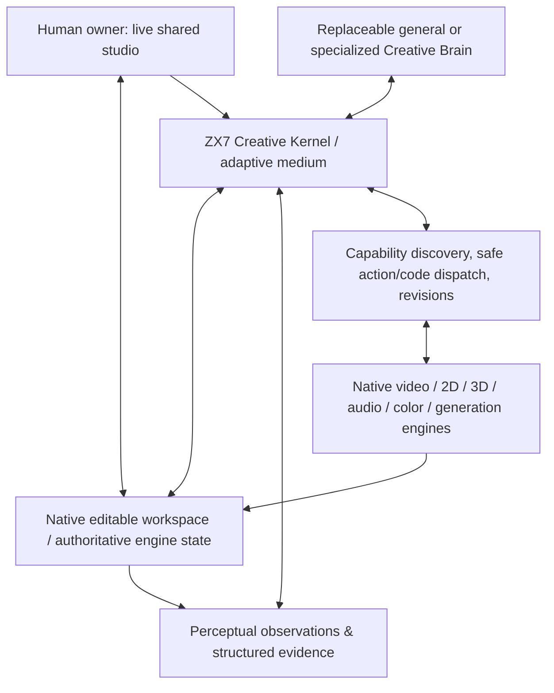

# ZX7 Creative Studio — Master Vision, Architecture, Research, Decisions & Execution Contract

> **Status:** Authoritative *planning consolidation candidate*, 12 November 2026 (IST). It records the intended product and the proposed build strategy; it **does not** certify implementation or professional quality. No existing `CAPABILITIES.md`, `ENGINEERING_STANDARD.md`, `AGENTS.md`, or `project-brain/` ledger is silently superseded. Review/merge this document as a new planning record.
>
> **Repository baseline checked:** [`ZX7-Labs/Zx7-creative-studio-`](https://github.com/ZX7-Labs/Zx7-creative-studio-) `main` at `7242fd10886ce27350803dc2dc7eaa1bdb75777d` (10 November 2026, 14:17:27 UTC); 516 tracked blobs; 316 `studio_next/*.py` modules; 55 GitHub workflows. This is an inventory, **not** proof that every file was line-by-line audited.
>
> **Primary source of scope:** [`CAPABILITIES.md`](../CAPABILITIES.md), [`ENGINEERING_STANDARD.md`](../ENGINEERING_STANDARD.md), [`AGENTS.md`](../AGENTS.md), [`project-brain/BRIEF.md`](../project-brain/BRIEF.md), and owner-supplied `Vision & Standards v1.0`. Preserve the owner's private PDF outside public Git.

## 0. पढ़ने का तरीका और provenance

यह **एकीकृत design record** है—नया नारा, proprietary-model clone, 20-framework proposal या पहले किए काम का विकल्प नहीं। इसकी जरूरत इसलिए पड़ी क्योंकि चर्चा agent memory/handoff से शुरू होकर पूर्ण creative BODY, code-native control, hybrid representation, professional judgment, live human collaboration और release-grade engineering तक पहुँची। End में किसी एक नये विचार के कारण शुरुआती उद्देश्य छूटना स्वीकार नहीं।

हर consequential statement इन वर्गों में समझें:

- **OWNER REQUIREMENT:** owner का अपेक्षित outcome/constraint; इसे benchmark से साबित करने की जरूरत नहीं, पर capability claim बनने से पहले evidence चाहिए।
- **SOURCE-VERIFIED:** specified repository source, official documentation या measured CI/run से मिला सीमित तथ्य। दस्तावेज़ में लिखी इच्छा को implementation न समझें।
- **RESEARCH-REPORTED:** published authors/benchmark का result; ZX7 में reproduce नहीं हुआ।
- **DESIGN DECISION:** वर्तमान reversible architecture choice; बदलने पर स्पष्ट supersession और evidence जरूरी।
- **HYPOTHESIS:** proposed mechanism, expected benefit, measurable disproof; कभी verified feature न कहें।
- **OPEN GAP:** जरूरी क्षमता जिसकी end-to-end acceptance शेष है।

पूर्व चर्चा का *पूरा अक्षरशः transcript* सभी समयखंडों में उपलब्ध नहीं था। Original 11 November expert-team design और उसके **reconstructed**, न कि byte-identical, follow-up audit को पुनः पढ़ा गया; वर्तमान बातचीत और चार विस्तृत ZX7 research reports भी मिलाए गए। जहाँ मूल हटे हुए audit का exact wording उपलब्ध नहीं, वहाँ उसके बारे में दावा नहीं। Chat summary से उत्पन्न विचारों को source-verification का विकल्प नहीं बनाया।

**अंतिम design statement:** *ZX7 is a model-independent, local-first, source-responsible, professional creative BODY providing AI-native creative perception, expression, precise control, native editability, safe execution, physical feedback, revision, and a live shared human–AI workspace. The Brain chooses the art and the means of creation; trusted BODY enforces truthful state and action boundaries; professional quality is established by observed outputs, not by model reputation.*

## 1. शुरुआत से यहाँ तक — निर्णयों की chronological reconstruction

| चरण | चर्चा में वास्तविक सवाल | जो सुरक्षित रखना है | क्या बदला / क्या नहीं करना है |
|---|---|---|---|
| Oct 2026: universal BODY | केवल एक editor नहीं; भविष्य के कई engines कैसे चलेंगे? | Live capability discovery → exact contract → validated dispatch → physical feedback; hosted/local model दोनों | `Film IR` को हर domain का universal schema न बनाना; कोई giant hard-coded tool list नहीं |
| 8–9 Nov: solo-engineering expertise | एक सक्षम research/science/architecture/engineering team कैसे काम करेगी? | आठ जिम्मेदारियाँ: Lead, Scientist, Research Engineer, Software, Systems, Product/Design, Evaluation, Security; task-proportional activation | आठ fake agent personalities या उनकी fabricated biographies नहीं |
| 9 Nov: long-running memory/handoff | Chat limits/reset के बीच evidence/decisions कैसे बचेंगे? | Stable contracts + task-specific context + Git-versioned current state, append-only decisions, evidence pointers, checkpoint/handoff | हर turn massive MD dump, automatic summaries को ground truth, पुराना STATUS को current state नहीं |
| 9–10 Nov: native production | AI वास्तविक creative software में original media पर काम कर सकती है? | Source-pinned full editor, MLT/FFmpeg/Blender foundations, native save/reopen, source custody, permissions, real frame/audio checks | Scripted export को autonomous professional editing प्रमाण नहीं |
| 10 Nov: model-development route | Local weak CPU trials में waste; क्या NVIDIA इस्तेमाल करें? | NVIDIA-first **development and bounded tests**, end-user BODY provider-neutral, open-source/local-first | Paid NVIDIA endpoint permanent runtime dependency नहीं; previous live trial already spent/failed, no silent rerun |
| 11 Nov: whole-system audit | Memory नहीं, पूरा video/2D/3D/color/audio/UI/ops architecture क्या है? | A–L scope, existing source reuse, standards and research alternatives, rigorous evidence | बिना वजह full rewrite या all-framework pile नहीं |
| 11 Nov: medium/code-first | AI mouse चलाए या program/code से creative world बदले? | Tool control, structured graphs, isolated procedural code, specialized generation, native edits—**task-dependent choice** | `tool-first` या `code-only` को final ideology नहीं; coding alone artistic perception नहीं देती |
| 11 Nov: first-principles medium | क्या machine-native perception, time, space, material, emotion और feedback जोड़ सकते हैं? | Experimental Creative State Fabric (CSF), original media preserved, typed relationships and perceptual evidence | एक invented universal creative file format को native projects पर थोपना नहीं |
| 11 Nov: human co-creation | AI uncertain हो तो live इंसान उसी project में कैसे आए? | Shared editable workspace, interrupt/annotate/manual edit/compare/resume, human help on demand | हर छोटी action के लिए human approval mandatory नहीं |
| 11 Nov: frontier model assumption | बहुत शक्तिशाली, creative-specialist या future model BODY को कैसे use करे? | BODY capability ceiling किसी current LLM/2B की limit से तय नहीं; replaceable general/specialist brains | कमजोर model की creativity को BODY की structural limit समझना नहीं |
| 12 Nov: precision clarification | AI को इंसान जैसे mouse/eyes की नकल क्यों करनी पड़े? | **AI-perspective-native means:** inspect, plan, encode, program, render, sense, measure and choose whichever medium works best | Human interaction metaphor को mandatory GUI automation में बदलना नहीं |
| 12 Nov: before coding | कहीं पुरानी बात/गैप छूट तो नहीं गया? | Master specification, independent gap/risk register, dependencies, acceptance fixtures, rollback and source-linked audit | Planning perpetually दोहराना नहीं; spec complete होते ही evidence-driven implementation |

**Evolution rule:** नई बात पुराने requirement को तभी supersede करती है जब मालिक स्पष्ट रूप से कहे या contradictory evidence के साथ reviewable decision हो। Mere mention of an example (`car`, `cycle`, `mouse`, `fade`, `code`, `Claude Code`) कोई mandatory product workflow नहीं बनाता।

## 2. Immutable product intent / success definition

### 2.1 Owner requirements (not quality certificates)

1. **Maximum creative expressiveness:** Professional filmmakers, editors, cinematographers, VFX artists, animators, designers, colorists और sound specialists जिन वास्तविक objects/relationships/operations का उपयोग करते हैं, उनमें सूक्ष्म control; new ideas भी संभावित हों, सिर्फ presets नहीं।
2. **AI-perspective first:** Human hands/eyes/mouse की replication नहीं; machine-native structured state, native programmatic interfaces, source-aware perceptual observations, simulations and safe creative programs जहाँ लाभकारी हों। GUI तभी जब वही relevant capability का समर्थित route हो।
3. **Brain autonomously chooses both art and method:** Idea, style, cut, pacing, camera, geometry, tool/code/model/graph choice, iteration strategy और stopping criteria creative Brain तय कर सके। BODY factual guardrails लगाए, aesthetic presets नहीं।
4. **Model-agnostic capability ceiling:** Frontier general model, specialized film/vision/audio/3D models, smaller locally-run model and future unknown models integrate through versioned capability contracts. Weak model को कम creative performance मिल सकती है; BODY's correct source/security semantics नहीं बदलेंगे।
5. **Adaptive hybrid medium:** One expressive path पर निर्भर नहीं; typed native edits, declarative graphs, bounded procedural code, generative media and limited GUI all eligible. New creative technique को silently downgrade या fake transform न करें।
6. **Actual seeing and hearing:** Original frames, continuous/timed motion, audio/voice/music, semantic observations, geometry/material/light/camera state, performance evidence; model को उसके लिए compatible representation or modality access देना। Raw embedding numbers text model का universal perception substitute नहीं।
7. **Original, native editable deliverables:** Projects, layers, masks, tracks, curves, shaders, sound stems, sources and revisions remain re-openable. Export alone completion नहीं।
8. **Human + AI live studio:** Human may intervene directly when useful; AI must observe the new revision, respect manual edits, compare alternatives and continue. Human presence optional, not a crutch or universal gate.
9. **One coherent product:** Video, motion, vector/raster/typography, 3D/CGI/VFX, color/HDR, audio/voice/music, generation, creative research, reliable runtime, mobile/desktop UX, professional release; A–L all retained.
10. **Quality without false guarantees:** Target unusually high professional quality, originality, craft, security, reliability, efficiency and user value. Neither prompt nor framework guarantees perfection; independent checks are required.
11. **Simple and clean outwardly:** Minimal, high-signal UI; inside, components only when responsibilities materially differ. Avoid duplicating scheduler, store, memory, project truth, agent hierarchy or 3rd-party engine.
12. **Local-first, FOSS/self-hostable runtime:** Proprietary/paid inference may be optional during development; no mandatory paid API for end users. Each adopted engine/weights/media asset has separate license/provenance obligations.
13. **Owner autonomy and operational safety:** Routine reversible engineering decisions delegated. Hard-to-reverse, real-money, secrets, private data egress, rights, destructive changes and public launch require purpose-specific consent.
14. **Current feasible completeness first:** Complete presently feasible A–L capabilities to a disciplined product standard before treating post-launch evolution as a substitute for present work; future extensibility stays open.

### 2.2 Definition of done, not an MVP euphemism

Full scope requires: functioning installed owner workflow, professional-grade independent creative action, practical audio/video/graphics/3D controls, native fidelity, calibrated quality review, permissions, provenance, tests, recovery, reproducible packaging, and clear known limitations. A release candidate may conditionally support a platform before other platforms, but any unfulfilled A–L requirement remains visible, not removed. **No whole-domain complete claim while its documented acceptance gate is open.**

### 2.3 Explicit distinction: BODY reach vs Brain competence

- **BODY reach:** discoverable, accessible, precisely semantics-defined and trustworthy controls; independent of model weights.
- **Model competence:** decision quality, modality understanding, error recovery, context and available inference resources; may vary widely.
- **Model provider compatibility:** transport/function-call/vision/audio formats adapted without changing project custody or native semantics.
- **Model safety/error handling:** malformed/unsafe output is rejected by the host; the product never silently corrupts media because a weak model chose badly.
- **Acceptance:** artistic output quality judged at project/result level, not inferred from the most famous model or high benchmark rank.

## 3. दो agent architectures जो कभी नहीं मिलनी चाहिए

### 3.1 Engineering team for *building* ZX7

The separately recovered **Expert Team Design Original** defined eight *coverage responsibilities*, not a mandated swarm of eight constantly talking agents. Reconstructed follow-up audit explicitly warned against fabricated work history, fake independent consensus and endless role rituals. Each role needs demonstrable work, not persona theater:

| Responsibility | Accountable output/evidence | Activate when |
|---|---|---|
| Principal / Technical Lead | Unified outcome, dependency-sensitive decisions, integration, migrations | Cross-cutting architectural or delivery tradeoffs |
| Research Scientist | Falsifiable questions, hypotheses, baselines, negative results | Novel medium/ML claims or unclear causality |
| Research Engineer | Reproducible implementation/experiments, benchmark controls | Models, perception, optimization, novel algorithms |
| Software / Product Engineer | Correct code, compatible integration, real working entry point | Runtime behavior/change |
| Systems / Performance / Reliability | Host resource metrics, memory/CPU/GPU, transaction/restart evidence | Failures, deployment, parallelism, cost/performance |
| Product & Design | Useful owner workflow, visual/interaction craft, professional usability | User experience and product capability |
| Evaluation & Quality | Separate measurement, adverse cases, grading of grader | Major claims and acceptance |
| Security & Privacy | Host trust boundaries, rights, leakage/malicious input tests | External content/code/private media/deployment |

Additional real expertise is **on-demand**: cinematic craft, DSP, 3D/rendering, color science, training, GPU kernels, database, frontend/accessibility, legal licensing. Technical leads integrate; facts are settled by evidence, not authority. The eight names do **not** imply eight real model instances. If real delegation is supported and independent work plus coordination is net-positive, use it; otherwise one accountable assistant covers the lenses without pretending independent reviews happened.

### 3.2 Runtime creative Brain *inside* ZX7

Default **one coherent artistic decision owner** plus optional specialist capabilities/models. If multi-agent collaboration genuinely helps, provide explicit scoped tasks, stable project versions and real handoff receipts. A filmmaker/editor should not have to converse with eight fictional personalities before moving one clip. A voice/vision/generative specialist can act as a model capability, not another independent truth owner. User may replace general Brain entirely with a specialized model that supports required operations; BODY stays constant.

**Rule:** Multi-agent architecture solves work distribution, isolation and specialty; it is *not* automatically the key to professional creativity. Benchmark a single-Brain baseline first.

## 4. Brain ↔ BODY ↔ Workspace: minimal logical architecture



These are **logical interfaces, not a mandate for services/microservices**. Do not add a second scheduler, media store or universal rendering engine. `Creative State Fabric` (CSF) remains a **candidate architectural mechanism** within the kernel; six concerns below do not demand six new modules/services.

### 4.1 Authority and data ownership

| Fact/decision | Owner of truth | Forbidden shortcut |
|---|---|---|
| Artistic goal, alternatives, edit intent | Brain; human may override | Host hardcodes genre, rhythm, shot count, palette |
| Actual timeline/scene/layers/curves/mixer state | Native application, identified project revision | LLM text/planned edit treated as applied state |
| Source identity, rights and original bytes | MediaVault/host custody | Guess source, cache or licensing from filename |
| Cross-domain references and change lineage | Versioned project envelope/index; native owner preserved | One giant lossy Film IR replacement |
| Capability names/contracts/availability | Live host-connected engine catalog | Model invents tool names or external rights |
| Permission, isolation, resource budget, side effects | Trusted host | Model grants itself shell, paid calls or filesystem roots |
| Technical pass/fail | Independent tools/physical readback | Tool returned `success` therefore film correct |
| Artistic preference/acceptance | Human-calibrated comparison, verified evidence, contextual reviewers | Fake universal beauty score or self-review certification |
| Current operator instructions and manual edits | Latest owner-approved workspace revision | AI overwrites human changes from stale snapshot |
| Durable operations, checkpoints and handoff | Host journal/repo project-brain | Chat summary alone is source of truth |

### 4.2 Shared creative project is an envelope, not a universal format

Common envelope includes: project UID, owner/rights, referenced native documents and revisions, source hash, provenance, rational time clocks, spatial transforms, color/alpha interpretation, audio channel/sample clocks, related-object references, dependencies, exposed affordances, conversion-loss warnings, and evidence links. Actual `.blend`, editor timeline files, SVG/native design, graph, sound sessions and EXR passes stay authoritative for their domain. Unknown extensions are preserved or conversion fails closed.

No 3D or audio-only project should need fake film shots. `studio_next/film_ir.py` stays film-specific until a measured migration is justified.

### 4.3 The hybrid creative expression routes

1. **Native application operations:** frame-exact NLE edits, mixer controls, established clip/keyframe UI state; high fidelity to app semantics.
2. **Declarative/editable graphs:** scene/object relationships, curves, nodes, SVG/2D effects, materials, compositors; inspectable, deterministic where possible.
3. **Validated procedural programs:** arbitrary geometry/effects/shaders/code when installed native operations cannot express idea; isolated, bounded, attested outputs, no host escape.
4. **Specialized creative models:** licensed image/video/3D/sound generation or perception, invoked as replaceable tools, always preserving originals and describing controllability limits.
5. **GUI fallback:** when accessible documented native functionality lacks an adequate programmatic route; no mouse emulation dogma.
6. **Compositions of routes:** Brain can choose a graph + procedural script + native edit + generated texture for a single creative intent, conditional on measured precision and native editability.

**Decisive user correction:** The *Brain*, not a fixed host aesthetic router, should creatively choose among plausible routes. Host may show constraints, cost, observed evidence and hard policy, and can reject impossible/unsafe writes; it must **not** silently substitute cheaper generic artwork for an ambitious scene. It can suggest alternatives with capability caveats; the Brain chooses art. If none supports the requested outcome, return an explicit gap and preserve desired intent.

## 5. Proposed machine-native creative medium: contracts, not a premature invention claim

**DESIGN/HYPOTHESIS — Creative State Fabric (CSF):** A *loss-aware coordination and control layer* bridging creative intent, native state, time/space/media, model observations, safe executable actions, outcomes and retained decisions. Its intended purpose is to increase **creative freedom, precise targeting and self-correction** without making a single new file format, engine or model mandatory. CSF's incremental benefit over the existing gateway is **unproven**; implementation requires controlled comparison.

### 5.1 Six responsibilities, one clean system

1. **Creative Intent:** goals, constraints, story causality, rhythm, dramatic/emotional targets, style choices and provenance of who selected them; editable, never a fixed formula.
2. **World & Native Project State:** concrete time-indexed clips/tracks; objects, meshes, rigs, materials, lights, cameras, nodes, masks, shape/text geometry, 3D and 2D coordinates; stable native IDs and versioned references.
3. **Perceptual Evidence:** real pictures/motion, speech and sound, embeddings only where the consuming model understands them, structured scene facts, uncertainty and observed intervals.
4. **Action & Program Language:** precise, inspectable edits and optional isolated programs, selected by model, transpiled to real validated capabilities; human edits use the same native truth.
5. **Verification & Review:** deterministic physical tests, calibrated perceptual checks and separate artistic comparison; report unknowns, not guess.
6. **Experience, Memory & Handoff:** which decisions were attempted, evidence, success/failure, owner overrides, context relevance and pending work; stale knowledge expires, revisions remain durable.

### 5.2 Design goals / invariants for the medium

- **Expressiveness without pretending universal completeness.** Any actual native feature may require a domain-specific adapter or new creative action; use capability discovery and typed extension points, not one fixed vocabulary masquerading as the entire creative world.
- **Observe-before-mutate.** Bind model action to actual project revision, object identity, source hash, coordinate/time conventions, grant and native write preconditions; if outdated, return `STALE_STATE`, not unsafe retry.
- **No closed semantic loop without physical feedback.** Model assertion → execution → native save/readback → actual decoded render/recording → technical and targeted artistic check → revision/rollback.
- **Editable fidelity.** Any edge crosses with explicit metadata and loss accounting. `.blend` objects should not degrade to opaque raster if the user expects editability. Generated imagery is not magically reverse-editable into source geometry.
- **Multiple representations serve different purposes.** Symbolic state provides exact coordinates; source audio/video provides signal; learned multimodal perception provides semantic hypotheses; no one represents all aesthetic meaning perfectly.
- **Non-destructive exploration.** Generate bounded alternatives in branches/versions, compare with evidence, preserve human choice and restore earlier state. Avoid creating unbounded combinations.
- **Cost-aware but not cost-dominant.** Cache fingerprints, cheap structural probes and targeted observations may precede expensive full renders/models, while quality-critical evidence cannot be skipped to save tokens.
- **Permissions never inherited from content.** Project text, downloaded prompt, file metadata, model-generated code, tool descriptions and external assets are untrusted.
- **Zero universal aesthetic presets.** Example of a fade or camera is a test case; not a fixed recipe for every film.

### 5.3 Candidate minimum typed operations (illustrative, NOT current ZX7 API)

```yaml
CreativeStateRef:
  project_id: stable-project-id
  native_document: engine-specific-source-reference
  revision: immutable-commit-or-digest
  source: verified-media-sha256
  object_id: actual-native-object-id
  observed_at: timestamp-and-native-version
  coordinate_space: explicit-2d-or-3d-space
  timebase: rational-frame-or-sample-clock

CreativeIntent:
  goal: "Increase tension through reaction timing" # arbitrary, non-preset example
  constraints: owner-brief-reference
  alternatives: []

ProposedAction:
  target: CreativeStateRef
  means: native_tool | graph | sandboxed_program | specialist_engine | gui
  parameters: capability-schema-versioned-document
  preconditions: revision-and-permission-proof
  expected_effects: editability-and-clock-and-media-constraints

ObservedOutcome:
  actual_native_revision: verified-native-readback
  physical_evidence: frame-and-audio-or-3d-inspection-receipts
  differences: measured-before-after
  creative_judgment: preference-with-provenance-and-uncertainty
  status: verified | rejected | partial | unknown
```

A Brain may propose choices and aesthetics; it cannot invent the signed `ObservedOutcome`. Engine owners produce native readbacks; host owns eligibility and evidence. This sketch is **not** the programming grammar for the implementation yet. Start from actual pinned editor/tool semantics, choose the smallest correct contract, version it, and run counterexample tests.

### 5.4 How AI chooses *means* as well as *art*

Desired control process:

1. Inspect current brief and *only needed* native/project/media evidence.
2. Identify desired effect and the smallest actual native object/region/interval impacted.
3. Discover feasible routes with affordance, expressive range, editability, resource, permissions and observation costs; **do not rank by model preferences hardcoded in BODY**.
4. Model chooses a route (or novel compatible combination), possibly tests alternatives; host independently checks contracts/permissions/versions.
5. Execute the selected bounded action; record intent, tool/program hashes, exact source and stage IDs.
6. Observe actual saved project and meaningful media windows; if uncertainty remains, increase observation resolution or request specialist/human help.
7. Critique *separately*: exact state correctness, perceptual deficiencies, creative preferences; compare candidate to baseline.
8. Revise surgically, preserve good work, or stop if quality and requirements are met; report anything unsatisfied.

This is **not** a mandatory 8-step prompt for every edit. Host may batch safe deterministic operations; model can work top-down or bottom-up. It is a fault-analysis/evaluation model, not a creativity-limiting script. For unsupported ideas, explicit failure with desired artistic goal preserved beats silent generic substitution.

### 5.5 Visual and audio: solve the correct problems

**The false binary:** "screenshots are too weak, therefore all creative perception should be code." A program can precisely *describe and mutate* native geometry, timeline, sound parameters and renderer state. It cannot reveal all human-observed taste or authentic footage content from source code alone; the same source code can produce different perception under differing assets, hardware and environment. Likewise sampled frames can miss temporal gestures, and a transcript can miss vocal delivery.

Use the *least-lossy, model-compatible evidence* needed for each question:

| Task | Cheap exact signals | Richer semantic observation | Physical oracle / uncertainty |
|---|---|---|---|
| Exact cut/transition | Rational time, clip adjacency, native duration | Sequence pacing/reaction continuity | Decoded frames at critical timecodes + sequence view |
| Object removal/roto | Mask geometry, source frames, tracking transforms | Occlusion, semantic target identity | Before/after across moving frames, alpha/edge artifacts |
| 3D camera/light/material | USD/scene nodes, transforms, photometric values | Mood, shape readability, cinematography | Actual render, shadows/reflections, multiple frames |
| Character animation | Rig joints, curves, constraints, temporal contacts | Acting, expression, weight/emotion | Motion sequence, contact/continuity checks |
| Color/HDR | OCIO/ACES pipeline, primaries, transfers, levels | Skin tone, subjective color intent | Correctly interpreted output and calibrated review |
| Audio cut/mix | Sample indices, channels, LUFS/peaks, phase/sync | Dialogue emotion, intelligibility, score/music | Actual listened signal, time-based probes and A/V alignment |
| Typography/graphic design | Vector nodes, bounding boxes, glyph shaping | Hierarchy, contrast, meaning | Correct rasterization + design review and editability |
| AI generated media | Requested constraints, model version, seed where possible | Semantics, aesthetics, fidelity, consistency | Licensed decoded assets, continuity review, provenance |

**Potential derived observations:** motion vectors, scene depth, image segmentation, speech words plus timestamps, phonemes, audio events/positions, spectrograms and multi-modal embeddings. Only use trained/compatible interpreters; an untrained text model cannot infer visual emotion from arbitrary numeric embedding arrays. Source media remains available and private. Store confidence, provenance, temporal coverage and negative/unknown results. Sensory subsystem must be interruptible, targeted, privacy-safe and benchmarked for semantic false confidence.

### 5.6 Emotional/creative judgment is a bounded research claim

Purpose/intent (narrative beats, anticipation, continuity, emotion, aesthetic preference) may guide proposals. **No deterministic scalar can certify all subjective professional quality.** Implement independent measurement tiers: (i) exact numerical contracts; (ii) learned perceptual hypotheses; (iii) blind A/B professional or calibrated human preference; (iv) unknown. A critic's model output is advice, not a quality certificate. Record alternative candidates and why each improved or did not; do not hide aesthetic regressions inside an aggregate score.

## 6. Live Human + AI collaboration without forced micromanagement

Target is **one real editable workspace**, not "send a video into chat, receive comments". Human can select clip/object/layer, manipulate masks/curves, scrub synchronized video/audio, annotate regions/time ranges, issue creative directives, pause agent work, compare alternatives and resume. AI sees **the actual latest revision**, not a fictional transcript of that edit.

Engineering invariants:

- Native editor or app state is authoritative; session model has observed state **with version**, not ownership over document bytes.
- On human edit, invalidate stale model snapshots/actions. Use compare-and-swap or revision guard where supported; actual native app may lack atomic cross-engine writes, so stage/snapshot/reconcile conservatively.
- Human changes can be mixed with AI work through named versions/branches and preview candidates, not overwritten by a late async write.
- Transparent controls: **Auto**, **Review uncertain**, **Manual override** are product modes to test, not a claim that every task can be automated safely. Confidence alone does not control rights or irreversible actions.
- Human involvement **minimized where possible**, readily available whenever expert artistic judgment matters, and never required by default for every fade.
- UI should expose real media, actual native features and project metadata, not only agent thoughts. Accessible keyboard and precise timeline selection, low-latency previews, undo and source-aware comparison are essential.
- Live work doesn't mean realtime path tracing/4K final render; distinguish interactive proxy, targeted final evidence and completed deliverables.

## 7. Agent memory, handoff, context and long-horizon reliability

This returns explicitly to the **first discussion**. Memory is not a giant prompt; handoff is not a pretty recap. Both are operational contracts for maintaining correct action across model/context/session boundaries.

### 7.1 Three planes — preserve existing `project-brain`

| Plane | Examples | How it enters the Brain context | Truth/update rule |
|---|---|---|---|
| **Stable instructions/contract** | `AGENTS.md`, `CAPABILITIES.md`, `ENGINEERING_STANDARD.md`, owner vision, authority/security | small authoritative references, exact excerpt for decision | versioned; explicit supersession only |
| **Task/working context** | current brief, selected source assets, installed tool contract, relevant prior decisions, current project refs | retrieve on demand, bounded and relevance-ranked | source pointers, dates, current rev/rights |
| **Operational state** | journal, last acknowledged action, status/retries, native project head, pending review, evidence, token/resources, next action | fresh host-signed readback and checkpoint | actual current machine state; refresh after writes/resumes |

New project-specific memory may include creative preference and artistic history **only if user-approved and source-grounded**. Do not blur an operator's taste with old model guesses. Model-generated memories are vulnerable to stale content, poisoning and false authority; evidence-backed admission and expiration are design candidates. No automatic arbitrary training/fine-tuning is implied.

### 7.2 Minimum handoff envelope (concept; schema pending)

```yaml
handoff_version: 1
objective: exact-task-goal-and-nonnegotiable-constraints
source_baseline: repo-commit-sha + tool-and-model-versions
workspace: native-project-and-media-refs-not-private-binary-copy
observations: receipts-with-provenance-and-time-coverage
decisions: accepted-and-rejected-with-why
progress: verified-completed-work-with-source-links
operations: last-acknowledged-write-and-uncertain-attempt-ids
open_gaps: tested-failures-vs-unverified-assumptions
permissions: remaining-host-grants-and-budgets
next_action: single-highest-value-safely-runnable-task
```

**Receiver protocol:** check handoff reference against current repo, project head, tool registry, original rights and actual editor state; distinguish past suggestion from acknowledged write. If uncertain native write was in flight, reconcile before retry—never blindly replay. A compressed summary may speed resumption but must retain exact source pointers; provenance, conflicts and `UNKNOWN` cannot disappear in compaction.

### 7.3 Multi-agent delegation conditions

Delegate only when: separate objective and interface, actual accessible tools, clear source ownership, isolated file/project writes, bounded budget, independent evidence possible and expected benefit greater than handoff/reconciliation overhead. Prefer parallel **read-only** research, tests or isolated artifacts; serialize conflicts on one native editor/project. No false claims of running multiple independent specialists when only one model produced all voices. Maintain a single final accountable integration owner.

### 7.4 Memory and agent research: what to borrow, not blindly install

| Prior art / source | Mechanism worth assessing | Why not plug it wholesale into BODY |
|---|---|---|
| [Anthropic: Effective harnesses for long-running agents](https://www.anthropic.com/engineering/effective-harnesses-for-long-running-agents) | fresh-context agents, feature verification, durable progress, staged evaluation | example workflow is coding-domain, not film-native multi-app state |
| [Anthropic: Managed agents](https://www.anthropic.com/research/managed-agents) | model-independent harness/interfaces, question staleness of model-specific scaffolding | not permission to copy proprietary internals |
| [Anthropic: Effective context engineering](https://www.anthropic.com/engineering/effective-context-engineering-for-ai-agents) | select relevant instructions, tools, history and sources | still requires current source-state checks |
| [HSC-Bench](https://arxiv.org/abs/2610.36523) | evaluate lost constraints across 1,039 long-horizon handoffs | published conditions not a ZX7 creative bench |
| [TRACE](https://github.com/xiong-wenjun/TRACE) | reject expired/stale memory when world state changed | redundant durable stores and overhead possible |
| [Mem++](https://github.com/AIDAChip-Inc/mem-plus-plus) | attributed append-only decision records | external storage assumptions and complexity may not fit existing SQLite |
| [Decision Context / Forge](https://github.com/NimaVahdat/decision-context-memory) | decision rationale, conflicting constraints, measured handoff behavior | authored benchmark effect is not a ZX7 measured improvement |
| [SubMem](https://github.com/Jasonya/SubMem) | compare alternative substrate designs | no reason to install all tested substrates |
| [LangGraph persistence docs](https://docs.langchain.com/oss/python/langgraph/persistence) | snapshot/checkpoint/interrupt patterns | ZX7 already has `durable_graph.py`; replacing it needs measured gain |
| [MemoryDojo](https://arxiv.org/abs/2611.09721) | poisoning/untrusted memory adversarial tests | evaluate attack relevance before architecture complexity |

**Selection:** retain `project-brain` (engineering memory), `durable_graph.py` (execution persistence), `body_project_heads.py` (creative document version heads), `CapabilityAttemptStore` (native action ledger). Add only minimal metadata/index/retrieval/admission mechanisms shown necessary by handoff and stale-state tests; avoid a parallel "memory brain" that owns conflicting project truth.

### 7.5 Context budget and cost discipline

- Discover tools by intent and inspect selected **exact schemas** only. Cache unchanged proven tool descriptions / state summaries without hiding changed grants.
- On overflow, retain non-negotiable constraints, source references, latest state and last acknowledged write; summarize low-value intermediate dialogue, not actual current documents.
- Use cheap offline validation before bounded paid frontier inference; don't invoke huge GPU only to discover a reproducible source schema defect.
- Record per-provider model/context limits and semantic difference between native function calling vs JSON/other formats. BODY capability remains stable despite format adapters.
- A controlled, visible checkpoint is preferable to silently dropping older constraints. Measure both memory recall and malicious instruction resistance.

## 8. Current repository reality and sources to keep

**VERIFIED inventory:** Latest accessible default branch checked at `7242fd...`, 516 blobs, 316 `studio_next` Python modules, 55 workflows, 40 open PRs returned by first paginated page (the first page is not the total open count). Latest same-head CI includes a project-brain integrity check and an all-tracked-source inventory check; these are **not** full creative/security certifications. An earlier exact-integrated candidate ran nine passing engineering workflows; the source/CI references are in `project-brain/STATE.md`.

**Verified lower-level work:** source-pinned Velorn editor at `b3c02adbd5c0779feb8abf34978299e9502cc0e7`; real scripted native project create/save/reopen, independent frame/audio physical checks, source hashes, installed Ubuntu workflow, layered MLT and editor tests. **Unverified high-level result:** independent expert-accepted model-driven original film, fully reliable human+AI live session, complete cross-domain professional controls or release readiness.

### 8.1 Source-to-responsibility map

| Existing module/path | Keep/inspect responsibility | Known limit or audit question |
|---|---|---|
| `CAPABILITIES.md`, `ENGINEERING_STANDARD.md`, `AGENTS.md` | Canonical product and engineering mandates | No code presence can mark full A–L complete |
| `project-brain/{BRIEF,STATE,DECISIONS,RISKS}.md` | Reproducible handoff, decisions and known risks | Sync after changes, never treat historical snapshot as live |
| `studio_next/capability_fabric.py`, `capability_gateway.py` | Real tool discovery, grants, typed admission | Current object inventory and grants must match connected engine |
| `studio_next/capability_attempts.py`, `capability_session_budget.py` | Durable write attempts and cost bounds | Cross-engine transaction guarantees not automatic |
| `studio_next/durable_graph.py`, `durable_sqlite.py` | Dependency jobs, SQLite WAL, leases, recovery | Project state and uncertain native writes require reconciliation |
| `studio_next/media_vault.py`, `body_archive.py`, `body_publication.py` | Original bytes, rights, retention, delivery | Cross-host source revocation and archive portability proof |
| `studio_next/body_project_heads.py`, `body_project_revision.py` | Immutable docs/heads, atomic JSON patches | Native app undo and shared human edits have distinct semantics |
| `studio_next/native_creative_control.py`, `native_editor_session.py` | Model-driven native tool control | Largest controller ~2,815 lines; examine complexity and real error handling |
| `studio_next/body_editor_mcp.py`, `body_editor_policy.py` | Source-pinned editor transport, host grants | Model must not broaden permission via tool text or code |
| `third_party/velorn`, `engines/velorn/` | Native NLE project, compositor, mixer, 130-tool MCP | Not every UI feature exported; GPL notices and source pin essential |
| `studio_next/body_mlt_*`, `body_timecode.py`, `precision_retime.py` | Precise multi-track NLE/retime/video source operations | Distinct renderer paths; do not silently mix incompatible clock semantics |
| `studio_next/film_ir.py`, `body_sequence_otio.py` | Film project plan, narrow OTIO exchange | Not a domain-neutral universal representation |
| `studio_next/body_visual_graph.py`, `body_visual_render.py` | Editable 2D/2.5D nodes/expressions | Complex effects, alpha, performance and trained feedback need physical proof |
| `studio_next/blender_scene.py`, `body_motion_project.py`, `body_cgi.py` | Procedural/declarative CGI and animation | Present `blender_scene` rejects arbitrary model-authored code: intentional safety boundary and expressiveness test |
| `studio_next/body_exr_passes.py`, `body_aces2_movie.py`, `body_color_pipeline.py` | Scene linear EXR/ACES2 and limited BT.709 LUT routes | Need cross-engine HDR/SDR, transfer and viewing consistency |
| `studio_next/composite_mix.py`, `body_loudness.py`, `voice_lab/` | Audio engine, sample metrics, voice/media | Exact listening and mix dynamics/legality incomplete |
| `studio_next/body_observation.py`, `body_review_compare.py` | Physical decoded frames/audio and factual differences | Explicitly no guaranteed story, emotion or aesthetic understanding |
| `studio_next/comfy_video_runtime.py`, `generative_video_providers.py` | Optional generation routes | Installed weights, GPU, licensing, quality and consistency unproven |
| `studio_next/body_creative_session.py`, `production_handoff.py` | Creative planning and task/session orchestration | Film-focused contract not necessarily reusable for posters/audio |
| `studio_next/body_mobile.py`, `body_desktop.py`, `body_service.py` | Owner control console / local service | Loopback-only service is not remote authenticated production UX |
| `scripts/repo_audit.py`, `.github/workflows/*` | Source inventory and specific CI suites | Inventory or scripted passes ≠ professional acceptance/security audit |

### 8.2 Actual negative evidence that must not be lost

- **Qwen 4B genuine local:** run [`42711402879`](https://github.com/ZX7-Labs/Zx7-creative-studio-/actions/runs/42711402879) failed after 46 decisions with 9,068 tokens exceeding 8,192 context; wrong-profile largely black output. Do not infer BODY cannot work merely from weak/model-context trial.
- **NVIDIA Nemotron 3.5 Super VL 120B:** owner-authorized genuine synthetic run [`42754872382`](https://github.com/ZX7-Labs/Zx7-creative-studio-/actions/runs/42754872382) failed owner delivery profile. Five MP4s were 1920×1080/24fps/6s without audio against required 640×360; four same SHA; tool decision truncation and strict journal classification caused abort. #292/#293 rectified known source guards, #297/#298 offline/physical CI passed, **but no subsequently successful genuine model run** is recorded at checkpoint.
- A later same-commit native scripted 60s picture/audio workflow had 1,440 640×360 @24fps frames and AAC; it tests engine fidelity, **not** model creativity or professional craft.
- Native preview, current object identity, concurrency, and auditory review remain live integration risk despite source-level fixes.

### 8.3 Current open-PR inventory: reuse, never blindly merge

At audit, PR [`#289`](https://github.com/ZX7-Labs/Zx7-creative-studio-/pull/289) addresses duplicate model prompt evidence / local context overflow; [`#236`](https://github.com/ZX7-Labs/Zx7-creative-studio-/pull/236) deals with native source/timeline state and missing clip IDs; [`#202`](https://github.com/ZX7-Labs/Zx7-creative-studio-/pull/202) explores validating native object IDs under host observations; [`#210`](https://github.com/ZX7-Labs/Zx7-creative-studio-/pull/210) offers opt-in SciPy convolution. Their current diff, CI, merge base, conflicts and overlap with main must be checked before reuse; open state is **not** approval or relevance. The repo contains multiple overlapping historic branches. Do not cherry-pick all issues without source comparison.

## 9. A–L full capability register: contract, present foundation, remaining proof

This table mirrors the **existing canonical `CAPABILITIES.md`** at a higher integration level; it must not replace the detailed original. Status for entire fields is **OPEN**; having test scripts or modules is not a certificate.

| Domain | Owner-facing professional outcome | Current candidate foundations | Must demonstrate before closure |
|---|---|---|---|
| **A — Truth/rights/ownership** | Import and use lawful source assets, credit and source custody | MediaVault, archive, publication | Immutable byte SHA and rights ledger, revocation, duplicate and remote/backup recovery, safe licenses and privacy |
| **B — Native project/interchange** | Full editable multi-format, multi-domain session | Film IR, OTIO subset, native graphs, heads, MLT/Velorn | Native roundtrip, loss report, cross-engine references for video/audio/2D/3D, unknown attributes retained or fail closed |
| **C — Professional video NLE** | Arbitrary professional cut, sync, trims, retime and transitions | Pinned Velorn, MLT, FFmpeg, native MCP | Genuine model-independent editorial decisions, ripple/roll/slip/slide, multi-track, keyframes, proxies, sound and editorial review |
| **D — Graphics/photo/vector/2D motion** | Rich editable graphic artwork and animation | Visual graphs, motion studio, planar | Typography/font shaping, masks, alpha, colors, layers, tracking, curves, meaningful edit/reopen and professional layouts |
| **E — 3D/CGI/VFX/simulation** | Fully art-directed native scene/control and realistic VFX | Blender scene/motion, EXR, CGI modules | Geometry/skin/rig, materials, lights, camera, particles/physics, compositing, procedural techniques, actual multi-frame/multi-view outputs |
| **F — Color/HDR/mastering** | Correct scene-linear and display-referred finishing | ACES2, LUT, film finishing | OCIO/ACES2 consistency, gamut transforms, SDR/HDR, alpha, >8-bit precision, image/video delivery matches rendered intent |
| **G — Sound/music/voice/subtitles** | Precise professional mixed, listenable audiovisual production | Composite mix, loudness, voice lab | Real audition/listening, source voice rights, multichannel/stems, dynamics, sample-accurate sync, subtitles, final loudness/true peak |
| **H — Original generative footage/assets** | Original or AI-generated assets integrated with manual editability where possible | Comfy runtime, providers, visual engine hub | Real weights/runtime/hardware/licensing/cost, character and temporal consistency, decoded output, editable limitations/provenance |
| **I — Orchestration/operations** | Reliable bounded multi-engine action and recovery | Capability fabric/gateway, attempts, durable graph | Crash/retry/lease/permission/conflicts, native state verification, no duplicate writes, observability, model/provider swap |
| **J — Perception & self-correction** | AI meaningfully sees/hears real results, spots and fixes problems | Physical observations, frame/audio compare, creative sessions | True time-continuous/video+audio task checks, native state binding, independent perceptual validation, blind artistic preference on hard jobs |
| **K — UX/live collaboration/privacy** | One clean live professional workspace, human and AI can both author | Velorn UI, Tk desktop, loopback mobile/service | Manual editing and AI continuity, compare/undo, authentication/HTTPS if remote, accessibility, backups and installed owner flow |
| **L — Professional release quality** | Different real creative assignments delight competent professionals | Existing tests/evidence scaffolding | Independently evaluated diverse outputs, license/supply chain, professional QA, installation, reliability, documented residual limits |

**Cross-cutting omitted-by-default traps:** typography kerning and font licensing; arbitrary object/rig identities; aspect/crop/color/alpha; sample vs frame clocks; occlusion/tracking; rights and provenance for generated/third-party media; human-live concurrency; multi-project privacy; native document/engine migration; renderer GPU/CPU availability; audio listening vs LUFS; semantic quality vs test passes; third-party GPL/AGPL; model memory poisoning. Register these in test fixtures and risk gates rather than adding massive services.

## 10. Alternatives and explicit decision record

| Candidate | Strength | Main failure mode | Current decision / evidence to revisit |
|---|---|---|---|
| **AI + GUI clicks only** | Full visible software UI and manual-like workflows | Latency, pixel inaccuracies, fragile UI state, inaccessible native semantics | Fallback only when no better native route; do not make system mouse-only |
| **AI + native tool calls only** | Typed authentic project operations, clear host permission | Missing programmatic coverage, too many low-level turns, expressive ceilings | **Baseline A**; retain proven secure route |
| **AI + unrestricted code only** | New procedural constructs and exact numeric control | Untrusted execution, unknown assets, model-cannot-see-results, editability failures | Reject *unrestricted*; **sandboxed code candidate B** |
| **One universal scene/film/JSON format** | Appealing unified appearance | Lossy audio/video/3D/typography/unknown attributes, big maintenance | Reject; domain-native authoritative state + thin typed links |
| **One powerful multimodal model does everything** | Fewer model handoffs | Vendor dependence, budgets, modality/error limits, no hard guarantee | Strong brain eligible, but BODY retains deterministic state and specialist options |
| **Always-on N agents** | Parallelism and specialist tasks | Fake independence, coordination cost, writes/conflicts, stalled delivery | Default one accountable creative Brain; conditional real specialist delegation |
| **Hybrid adaptive medium** | Combines expressive controls, targeted sensing, technical safeguards | Complexity, conversion loss, slow orchestration, critic loops | **Hypothesis C**, not selected as globally superior until A/B/C matched evaluation |
| **New editor/rendering engine from scratch** | Complete internal conceptual control | Recreates decades of mature native engineering at high failure cost | Reuse source-pinned mature engines; invent only control gaps proven by actual tasks |
| **All latest frameworks integrated** | Many fashionable features | Competing source of truth, redundant memory/scheduler and dependencies | Reject; select only a mechanism with measured incremental improvement |

### 10.1 Consistency conflicts resolved without changing scope

- **"BODY behaves like LLM" vs durable capability:** resolve as BODY exposes the **same expressive and safe control ceiling**; model decision competence varies. BODY is not a fake generative brain.
- **"Maximum independence" vs live human involvement:** implement AI-driven creation by default and non-blocking human steering when useful or required by actual risk; no universal manual approval.
- **"Code can be eyes" vs actual seeing:** code/static data gives exact structural state, while real encoded picture/audio plus compatible perception remains essential for perceptual/affective hypotheses. Both represent different information.
- **"One medium for everything" vs native fidelity:** one *coordination contract*, many authoritative domain-native representations; conversion must be loss-aware.
- **"Finish all now" vs first video field:** implement a **dependency-ordered complete roadmap**; first vertical closure is a test of the universal product, not scope reduction or a stop condition.
- **"No more decisions after starting" vs adaptive science:** pre-decide boundaries, acceptance and baseline; never promise no future design decisions when experiments reveal genuine facts. Material decisions are recorded and downstream effects reconciled.
- **"Research deep" vs avoid waste:** research only while it can change next technical decision; evidence value over publication quantity; move to code once hypothesis/gates clear.
- **"Highest model" vs model-agnostic:** frontier models are a **capability assumption for design stress testing**, not a fixed current ranking, mandatory API, provider name or end-user runtime limit.
- **"Professional quality" vs verified engineering fixtures:** keep creative evaluation independent of protocol, render, fixed spec and source-custody checks; passing all engineering tests does not equal accepted film.

### 10.2 Stable vs experimental vs superseded

**Stable locked requirements:** full A–L, high expressiveness, Brain/BODY separation, provider-neutral FOSS outcome, no source loss, host authorization, actual sensing, native editability, human/AI, evidenced quality, no arbitrary art presets.

**Selected current engineering baselines:** pinned Velorn as first full NLE, MLT/FFmpeg/Blender complement, existing custody/SQLite/host gate, one engineering project-brain, field C first.

**Experimental/reversible:** named CSF medium, choice/routing method, artist/reviewer memory admission, procedural code schema, multi-model subagents, creative preference estimators, cross-domain creative object links beyond proven data types.

**Rejected/superseded:** only GUI, tool-only dogma, code-only dogma, universal film IR, pretending prompt roles are real agents, forced huge MD context, fixed artistic pipeline, unverified "world's best" claims, paid NVIDIA dependency, blind use of stale PR/test results, release from scripted fixture, silent scope cuts.

## 11. Exact execution plan after consolidating this document

**Phases are dependency/acceptance gates, not arbitrary calendar promises.** A closed gate means code, verification, evidence and status have been observed at a specific revision—not just its tasks checked off in a note.

### G0 — Repository reconciliation and architecture lock (FIRST)

**Inputs:** This master file, canonical repo docs, `project-brain`, source tree, open PRs, CI/artifacts, owner vision and older research notes.

1. Confirm latest main SHA, source-pinned dependencies, 12-domain contract and all open PR overlap; do not trust historical counts.
2. Map each A–L requirement → installed engine/source owner → actual typed affordance/API vs UI-only capability → editable native document → observation/evidence oracle → gap status. Distinguish source-present, currently installed, scripted tested, true model-run and independent creative acceptance.
3. Trace **one complete execution path** through model adapter, capability registry/host gateway, native editor, source vault, save/reopen, render, perception and review. Inspect problematic modules plus relevant native Velorn implementation, not only docstrings.
4. Write a concise **append-only decision** in `project-brain/DECISIONS.md` referring to this full master record; update `PROJECT_MAP`, `RISKS`, `STATE` only with actual completed evidence. Keep older notes intact and link them; do not create a competing STATUS.
5. Define executable acceptance fixtures F01–F14, adversarial cases and installation toolchain. Compare open candidate fixes (`#202`, `#236`, `#289`) before any overlapping code.
6. Set budget and authorization for model trials; use NVIDIA-first only when a trial is actually justified and separately approved; keep no hosted runtime requirement.

**Exit gate:** single current source of truth, justified architecture choices, first owner workflow specified at exact native tool semantics, hard tests and baseline available, privacy/license constraints mapped, no unknown authority owner on writes. Does **not** require every file to have its line annotated.

### G1 — End-to-end independent native video creator, with live human intervention

Target: One real rights-attested brief and source pack → model independently discovers actual controls, chooses original creative direction/edits, saves real native project, renders **audible** conformant video, sees/hears relevant output, chooses targeted meaningful revision, produces independently verified second render, reopens saved native project, user manually intervenes and model resumes preserving that edit. Prove **picture + sound + artistic review** separately. Fix actual source mistakes, not invisible prompt patches.

**Preconditions:** installed pinned Ubuntu native editor, actual source/custody, correct selected export profile, frame+sample/time contracts, trusted action ledger, permissions, source versions, vendor/model transport constraints.

**Gate:** exact technical assertions pass; model selected nontrivial decisions without canned script; artifacts tied to same documented model/source/native revision; targeted improvement is actually observable and independently assessed. Test failure injection, wrong object ref, stale human edit and no uncertain replay. If one piece fails, report clear no-go and repair there without weakening criteria.

### G2 — Prove or reject the creative medium hypothesis

**A/B/C comparison** on at least video NLE, motion graphics, procedural 3D and audio-semantic tasks:

- **A:** Current native-tool baseline using real editor/project.
- **B:** Sandbox-validated procedural/code-native route with comparable affordances.
- **C:** Minimal adaptive medium coordinating native state/perception/route choices.

Use same model versions/settings and briefs, rights-cleared source pack, host limits, comparable compute/tool budgets and *held-out prompts*. Measure: exact correctness, expressive task resolution, native editability, artistic blind preferences, retries/failures, latency, cost and source/security regressions. Attribute any improvement with ablations (e.g., remove source-grounded observations or remove rich action description). Repeat where variance matters.

**Kill:** C adds measurable complexity/cost but no useful creative advantage; reverts/retains A or B. **Safety kill:** unauthorized execution, lost source rights/state, unsupported cross-engine flattening or hidden incomplete output. No superiority claim without observed result.

### G3 — Complete professional multidisciplinary A–L, not separate disconnected demo engines

Sub-vertical ordering follows shared dependencies and available source evidence, not fixed aesthetic workflow: D (photo/vector/typography/2D/2.5D/motion), E (CGI/3D/VFX/simulation), F+G (cross-domain mastering/audio/voice), H (licensed media generation where desirable), I+J (true multi-project reasoning/sensing/correction), A+B+K (continually across all), then L. Each domain closes with native editable results, physical proof, real model behavior, professional feedback and relevant privacy/license/recovery requirements.

When domain-specific functionality is UI-only, decide based on evidence whether to (1) extend source-pinned app surface safely, (2) use engine-authorized native code/graph, (3) add a specialist engine, or (4) keep GUI fallback. Do not compromise on an unsupported requested creative idea by silently changing style/genre/intent.

### G4 — Full owner experience, security and independent professional acceptance

Fresh supported install/package and source reproducibility, complete notices for MIT root/GPL+AGPL components and separately licensed weights/media, public source hygiene, sensible UI and review ergonomics, local-first execution, protected remote/mobile when supported, backup/recovery and migration tests, long/large project performance, actual cross-engine editability, and blind professional multi-genre acceptance. Release only with evidence-backed gate, not a date or count of workflows.

### 11.1 Engineering work pattern: fast but serious

- **1. Verify environment and baseline once, with cacheable receipts.** Do not rerun the whole suite after a comment edit.
- **2. Select one meaningful integration failure/dependency, trace its true source owner.** A tool failure may belong to the renderer, adapter, model format, media rights, source data or perception; isolate before coding.
- **3. Implement a coherent reusable fix.** Preserve interfaces, use mature source where suitable, avoid duplicate stores/call paths, guard real permissions.
- **4. Run focused deterministic/physical tests, then an integrated final suite at exact source revision.** Repair failures together and rerun affected suites, not just a quick cosmetic fix.
- **5. Run limited real inference/creative review only where code cannot independently prove behavior.** Record actual runs, model versions, outputs, and negative evidence; never spend paid quota to test already-known schema bugs.
- **6. Independent check, review, merge and update current project-brain.** All claims point to exact SHA, artifact and tool/result.

This avoids a ritual of one tiny patch per conversation, but it does not promise every hidden integration failure can be pre-known. Impactful experiments change the plan; goal/quality constraints remain protected.

## 12. Verification matrix — tests to prevent omitted functionality

| ID | Scenario / counterexample | Must actually observe | Status at 12 Nov |
|---|---|---|---|
| T01 | Natural language brief, nontrivial choices | Genuine model trace, no authored creative script | **OPEN** — earlier genuine trial failed |
| T02 | Raw source → native project → export | Valid original SHA, editable save/reopen, decoded final | **PARTIAL:** scripted physical CI passes |
| T03 | Correct 640×360 owner profile vs HD default | Real configured export and exact spec | **OPEN model test:** earlier wrong-profile NVIDIA outputs |
| T04 | Actual audible speech/music and A/V timing | Decoded PCM, listening review, lip-sync/sound event checks | **OPEN:** scripted audio proof, no model artistic listening acceptance |
| T05 | Targeted creative revision of one scene | Real source-backed changed media and preserved alternatives | **PARTIAL:** scripted yes, end-to-end creative independent no |
| T06 | Native project restored after process death | Same references, no double write, no lost owner media | **PARTIAL:** some tested paths; long-form/concurrency unverified |
| T07 | Live human edits while AI acts | Stale edit rejected, manual edit retained; AI resumes new rev | **OPEN:** integrated co-edit acceptance absent |
| T08 | New creative idea beyond current graph schema | Correct native or safe procedural route or explicit gap, not prefab | **OPEN/HYPOTHESIS** |
| T09 | Heavy 3D rig/skin/camera/lighting/VFX | Editable Blender-native control and real multiframe quality | **OPEN field E** |
| T10 | Vector/typographic motion and alpha | Editable layers/paths/fonts with pixel/time verification | **OPEN field D** |
| T11 | HDR/gamut vs SDR | Correct declared OCIO/ACES transfer/gamut cross-engine | **OPEN full field F** |
| T12 | Generated media/weights/rights | Real installed license-compliant inference and provenance | **OPEN full field H** |
| T13 | Native object ID guessed/stale | Pre-dispatch fail closed, no accidental edit | **PARTIAL; source guard candidate PRs to inspect** |
| T14 | Weak 2B Brain versus frontier Brain | BODY exposes same capability and safety; artistic skill differs | **OPEN comparative test** |
| T15 | Compacted handoff across contexts | Original user limits, source pointers, latest head retained; stale rejected | **OPEN empirical test** |
| T16 | Malicious retrieved instructions and memory poisoning | No elevation, exfiltration or stale permission inheritance | **OPEN adversarial evaluation** |
| T17 | Rich graphics and audio-only projects | No fabricated film-shot requirement; native editability | **OPEN B/D/G** |
| T18 | Long project performance/cost | Peak CPU/VRAM, latency, output quality, memory measured | **OPEN realistic workload** |
| T19 | Multi-model/specialist model swap | Same contracts, new semantic capability accurately reported | **OPEN provider compatibility matrix** |
| T20 | Independent professional film judgment | Blind preference vs competent baseline, human disagreement recorded | **OPEN L** |
| T21 | License/secret/owner data publication safety | SBOM/notices, no public private media/secrets, source revisions | **PARTIAL + independent release audit open** |
| T22 | Full UI owner flow | Installed run, create/edit/review/revise/export/reopen/undo in same workspace | **OPEN K** |
| T23 | Model routes to tool/code/graph with real freedom | Observed route choice, safe equivalence and quality improvement | **HYPOTHESIS C** |
| T24 | Failure after correct tool output but before journal acknowledgement | Reconcile unknown side effects; no unsafe retry | **OPEN full multi-engine proof** |

"PARTIAL" means specific foundations exist; do not silently promote to PASS without exact current source and evidence. For the *first G1 vertical*, ensure T01–T07, T13, T16, T20–T22 have an explicitly scoped demonstration; G2/G3 close the rest.

### 12.1 Test case admission and outcome metadata

Every proof should bind `{case, exact source SHA, package/engine pin, chosen model/settings, original source/rights, sandbox/grants, actual project revision, native action journal, decoded frame/audio evidence, evaluator/judge identity or method, expected thresholds, actual measured results, failure/unknown, artifact digest}`. Compare *same* input across alternatives; isolate newly added model/compute/library change. Keep genuine negative outcomes and grader false positives; external specialist assessment cannot be simulated with one model's self-critique.

## 13. Risk register and anti-regression controls

| Risk | Why material | Containment/exit |
|---|---|---|
| **R01: missing genuine creative loop** | Much source exists, but AI-chosen film/audio quality not accepted | G1 model-selected end-to-end paired A/V + independent creative review |
| **R02: model API quotas/cost/availability** | NVIDIA trial may fail, and no required hosted product runtime | Offline prerequisites, bounded opt-in run, provider-neutral fallback, no unapproved duplicate |
| **R03: current brain tool/context limitations** | Weak model output can suggest false BODY weakness | Separate transport, Brain competence and BODY safety/capability tests |
| **R04: poor temporal/audio perception** | Screenshots and loudness stats miss acting, sound quality, synchronicity | Source-grounded continuous/targeted A/V observations + human-calibrated reviewers |
| **R05: domain-breadth failure** | Pretty film demo can hide absent 3D/typography/HDR/audio | Whole A–L matrix must remain open until field-specific acceptance |
| **R06: lost expressive freedom** | Rigid schemas force canned low-quality output | Explicit unsupported gap or authorized code/graph/native path; adversarial novel brief |
| **R07: project truth splits** | Multiple scene graphs, native timelines, caches and humans disagree | One authoritative native owner per domain; versioned envelope and physical readback |
| **R08: concurrency and non-idempotent writes** | Model/human race, duplicate native changes | Versioned compare/reconcile, host durable ledger, no uncertain write replay |
| **R09: generated or untrusted code** | Arbitrary model programs can leak files/execute tools | Isolated minimal privileges, no default network, bounded CPU/GPU/memory/time, checks and audit |
| **R10: misleading artistic scores** | VLM critique can reward technical compliance but poor craft | Blind pairwise professional checks, independent calibrations, creative uncertainty |
| **R11: hidden license/asset incompatibilities** | GPL editor, AGPL candidate, generated assets/weights differ | Exact pinned source, notice inventory, license matrix, no assumed sublicensing |
| **R12: overengineering and cost** | New medium could become second app/DB/agent stack | Matched A/B/C experiment; minimum real incremental implementation, kill ineffective abstraction |
| **R13: continuity drift/history loss** | Previous deleted report, stale PRs, current source artifacts expire | Append-only decisions, dated state, pointers, exact hash, branch PR and backup |
| **R14: user workflow gap** | Engineering harness works but owner can't edit/review naturally | End-to-end installed UI tested on realistic work; accessible direct human controls |
| **R15: source research and copyright** | Global visual/music research can misattribute or import unlicensed inputs | Rights-aware research retrieval, source provenance, generated/private media isolation |

**Unacceptable false completions:** “100% verified” solely from CI; “independent review” performed by same speaking model; claiming entire creative range from installed app; model-intent JSON treated as exact applied native state; code-native program success treated as visual/artistic acceptance; an open PR treated as merged feature; author benchmark claims treated as ZX7 measured wins.

## 14. Source-backed research atlas — ideas, tests, and limits

The following are *references to decision-relevant original papers, official documentation or executable implementations*, not a claim that all have been independently reproduced in ZX7. Numbers, where quoted, are author/benchmark-reported and may be specific to their own datasets. No source here grants rights to weights, footage or music.

### 14.1 Historical computational cinematography and perception

1. [The Virtual Cinematographer (1996)](https://www.microsoft.com/en-us/research/publication/the-virtual-cinematographer-a-paradigm-for-automatic-real-time-camera-control-and-directing/) — hierarchical camera/director rules show that cinematic operations have structured semantics; do **not** freeze human film grammar as the only artistic option.
2. [Attentional Theory of Cinematic Continuity](https://ualresearchonline.arts.ac.uk/id/eprint/21187/) — attention/continuity across cuts is not identical to timecode correctness. Treat emotional impact as context-dependent hypothesis.
3. [OpenUSD specification and composition](https://openusd.org/release/intro.html) — references, payloads, layers, overrides and native scene composition; inspiration for 3D native state plus non-destructive collaboration, not a film/audio universal document.
4. [OpenTimelineIO](https://opentimelineio.readthedocs.io/) — editorial interchange semantics and adapters; extension/effect fidelity is not lossless across arbitrary apps.
5. [MaterialX](https://materialx.org/) — interoperable material/graph descriptions; may preserve typed shading semantics across relevant 3D engines.
6. [OpenColorIO](https://opencolorio.org/) and [Academy ACES](https://www.acescentral.com/) — explicit color interpretation, transforms and pipeline correctness; do not infer scene-linear/HDR mastery from 8-bit screenshots.
7. [ImageBind](https://ai.meta.com/research/publications/imagebind-one-embedding-space-to-bind-them-all/) — cross-modal learned representations can aid similarity/retrieval; embedding is not human-readable image/audio code by itself.
8. [ST-AudioLM](https://aclanthology.org/2026.emnlp-main.2043/) — models timed/spatial audio events; its performance does not certify an audio mix or listener emotion.
9. [Audio Flamingo 3](https://research.nvidia.com/labs/adlr/AF3/) — audio-language perception tools may add meaningful source-grounded semantic evidence; confirm licensed availability/runtime separately.

### 14.2 Modern editable content and professional quality

10. [TimelineBench paper/docs](https://timelinebench.tensortest.com/paper), [live leaderboard](https://timelinebench.tensortest.com/) — 56 real video-edit tasks. Initial paper: 16 setups, best **15/56**; live leaderboard reviewed 12 Nov: 19 setups, best **18/56**. These are *different* evaluation snapshots, not a contradiction. Most failures pass objective delivery/brief tests but miss human-calibrated editorial quality; inaccessible/rights-restricted source footage limits unrestricted reproducibility.
11. [MotionGraphicsBench](https://arxiv.org/abs/2611.10592) and [dataset](https://huggingface.co/datasets/figma-ai/motion-graphics-bench) — 100 SVG animation tasks; deterministic verifiers agreed **93.3%** with humans over reported validation set (versus an **83.3%** VLM judge). This measures requirements more than aesthetic taste.
12. [BlenderWorld](https://github.com/QwenLM/BlenderWorld) — 223 editable Blender tasks, 2,651 binary criteria; full-rubric success significantly harder than average per-criterion success. Valuable multi-view geometry, camera, material and structure oracle.
13. [Nova3D](https://arxiv.org/abs/2607.22738) — code-native 3D can preserve numeric constraints and local editability; evaluate Blender sources and downstream polish independently.
14. [CodeGen-3D](https://scholarworks.sjsu.edu/faculty_rsca/6835/) — iterative specialized Blender programming can reduce execution errors; task-specific author results are not proof of broader artistry.
15. [WeVisCut](https://github.com/Tencent/WeVisCut) — trained tool-policy for narration-driven video with controlled trajectories and author-reported token/quality advantages; not universal 3D/VFX or an automatic FOSS runtime choice.
16. [ReDesign](https://github.com/jintae-00/ReDesign) — coarse-to-fine editable design layers; don't mistake single flattened image quality for retained graphics/typography affordances.
17. [Auto-Director](https://arxiv.org/abs/2610.28346) — multi-role video research; compare its additional roles against one-Brain baseline rather than adopting a multi-agent ideology.
18. [VideoAgent](https://arxiv.org/abs/2606.23327) — task-specific specialized editing delegation; different benchmark and scoring from TimelineBench, cannot directly compare headline percentages.
19. [AV-SyncBench](https://github.com/Duck-Boss/AV-SyncBench), [FAVE (CVPR 2026)](https://openaccess.thecvf.com/content/CVPR2026/html/Lu_FAVE_A_Structured_Benchmark_for_Fine-Grained_Audio-Visual_Temporal_Evaluation_in_CVPR_2026_paper.html) — audio/video temporal and semantic synchronization; implement minimum synthetic clocks first, calibrated perception when compute allows.
20. [Agentic Design Review System](https://research.adobe.com/news/agentic-design-review-system-teaching-ai-to-review-graphic-designs-the-way-experts-do/) — structured graphic craft critics are a candidate specialization, not unquestionable subjective truth.
21. [VisEditBench](https://aclanthology.org/2026.emnlp-main.1038/) — render-grounded code editing is evidence for observe/execute/render/revise loops, not proof code alone can "see".
22. [CLI-Anything](https://github.com/HKUDS/CLI-Anything) — build AI-oriented programmatic control surfaces over mature apps; compare exact installed source and capabilities rather than assuming exposed tool count means creative completion.

### 14.3 Agent engineering, context, handoff and control safety

23. [Anthropic: Building effective agents](https://www.anthropic.com/engineering/building-effective-agents) — use agents/workflows to match task; added autonomy should justify complexity.
24. [Anthropic: Effective context engineering](https://www.anthropic.com/engineering/effective-context-engineering-for-ai-agents) — context includes tools, history and external state; relevance and authority matter more than an unlimited prompt dump.
25. [Anthropic: Effective harnesses for long-running agents](https://www.anthropic.com/engineering/effective-harnesses-for-long-running-agents) — fresh-context resumption, durable progress and test-backed completion, adapted to ZX7 native project state rather than cloned literally.
26. [Anthropic: Managed Agents](https://www.anthropic.com/research/managed-agents) — explicitly warns that harness assumptions about model limitations can become stale. Preserve a powerful replaceable model interface without fixed weakness-induced clamps.
27. [Anthropic: Demystifying evals](https://www.anthropic.com/engineering/demystifying-evals-for-ai-agents) — distinguish actual world-state success from plausible model response; graders themselves need tests.
28. [HSC-Bench](https://arxiv.org/abs/2610.36523) — handoff communication benchmark; adapt error categories to creative state/version continuity.
29. [TRACE](https://github.com/xiong-wenjun/TRACE), [Mem++](https://github.com/AIDAChip-Inc/mem-plus-plus), [Decision Context benchmark](https://github.com/NimaVahdat/decision-context-benchmark) — provenance/time/admission ideas; **not** three products to install wholesale in ZX7.
30. [LangGraph persistence](https://docs.langchain.com/oss/python/langgraph/persistence) — checkpoint/interrupt design reference; ZX7 already possesses a SQLite durable graph and should avoid redundant runtime state.
31. [MemoryDojo](https://arxiv.org/abs/2611.09721) — memory poisoning shows that long-term summaries are untrusted inputs, not executive authority.
32. [MCP specification](https://modelcontextprotocol.io/specification/2025-11-25) — protocol/transport semantics useful for native tool interoperability; model cannot infer permissions from protocol existence.
33. [OWASP Agentic Security](https://genai.owasp.org/initiatives/agentic-security-initiative/) — tool misuse, untrusted content, data exposure and agent authority threats; map to actual native host boundaries.
34. [SLSA](https://slsa.dev/) and [C2PA](https://c2pa.org/) — supply-chain and content provenance ideas; claim conformance only if entire relevant verification is performed.
35. [SQLite WAL documentation](https://www.sqlite.org/wal.html) — underpin crash/recovery choices and limits; SQLite durability itself does not give atomicity across external editor state.

**Reproducibility rule:** preserve paper version/date, repo commit/tag, weights+license, dataset access, evaluator and workload differences. Benchmarks with restricted footage, hardware/VRAM or specialized vendor models are *research guidance*, not CI-gate-in-a-box. No paper above by itself proves a universal professional creative medium exists.

## 15. What was checked, what was not, and the deliberate research stop

### 15.1 Inspected in this consolidation

- Owner-supplied **Vision & Standards v1.0** two-page document (read as user-authored criteria; private contents not uploaded into public Git).
- `Expert_Team_Design_Original.md` dated 11 Nov 2026, **58,771 bytes, SHA-256 `d61f2fe8d7219c75cf822959a3972fa9d836ee4d956a691d94b0e53a202adc26`**; its eight responsibilities, boundaries, work samples and desk reviews were reviewed.
- `Expert_Team_Audit_AI_Mapping_Rebuilt.md`, **26,837 bytes, SHA-256 `451c230bd37e87536aeb0c1ac2b6b75087aadafff2ca2aeaf3861a7f5a32128d`**; expressly a reconstruction, not recovery of deleted exact audit text; no target-model team-claim evaluation completed.
- Four prior local ZX7 reports: `ZX7_Studio_Full_Architecture_Research_Audit_2026-11-11.md`, `ZX7_Creation_Architecture_Reassessment_2026-11-11.md`, `ZX7_Creative_Medium_First_Principles_Research_2026-11-11.md`, and `ZX7_Preimplementation_Completeness_and_Execution_Blueprint_2026-11-12.md`.
- Connected GitHub current `main` commit, full file path inventory, 20 recent workflow results, first 40 open PR snapshots, and specific canonical docs/source modules. Representative source code for capability gateway, native controller, document heads, observation, native creative sessions, mobile/desktop, editor MCP, graphs and procedural Blender was read at least in relevant opening sections; full repo whole-file, third-party submodule and all runtime data paths **not** re-reviewed line by line in this consolidation.
- Targeted additional official/primary sources for model-neutral harnessing, scene composition and editing-evaluation results. External paper claims were neither reproduced nor accepted as ZX7 measured results.

### 15.2 Not executed / unresolved

No code implementation, no repository mutation before a review branch, no NVIDIA paid model run, no source/CI test execution in this planning work, no runtime creative-audio listening, no independent professional editor evaluation, no human-in-loop live editor session, no field A–L fully accepted. Prior exact-source workflow results remain **historical documented evidence** and must be refreshed on the commit being tested. Source file existence proves **potential** behavior, not installed capability. Exact original lost agent audit text is unavailable; reconstruction is labeled as such.

### 15.3 Why research can now give way to disciplined implementation

The biggest uncertainty no longer concerns *what product is being built*. That has been repeatedly clarified and now protected by contracts. The highest information value is currently a complete native model/editor/perception/human loop and a matched code/tool/hybrid test. Further generic survey without a discriminating experiment risks wasted time. Reopen targeted research when actual observed gap changes architecture, API, algorithm, or professional acceptance threshold. This is not a declaration that all future scientific questions have been solved.

## 16. Next session handoff: execute, do not restart the vision discussion

**CURRENT GOAL:** Implement the full A–L ZX7 professional creative BODY, beginning with G0 repository reconciliation/architecture-lock and G1 real native video completion, without limiting BODY to current model knowledge or one control medium.

**UNMODIFIED REQUIREMENTS:** Original owner Vision, Canonical `CAPABILITIES.md`, `ENGINEERING_STANDARD.md`, local-first/FOSS, privacy/source custody, model independence, creative method freedom, live human collaboration, professional review, honesty about unverified status.

**REPO BASELINE TO REFRESH:** `main` `7242fd10886ce27350803dc2dc7eaa1bdb75777d`; compare to latest GitHub main before action, then read open PRs, STATE/RISKS and source pins. Past run `42754872382` failed; previous specific NVIDIA one-shot authorization is exhausted.

**FIRST ACTION:** Reconcile G0 live repository and candidate PRs, confirm trusted native source/identity/observation/runtime contracts, append new decision(s) instead of overwriting old ones, implement executable F01–F14 acceptance harness and a first targeted source fix where missing. Avoid duplicate scheduler/store, broad rewrite or arbitrary new memory framework.

**IMPLEMENTATION START ACCEPTANCE:** exact-source tests, source custody and native revision physical proof, authorizations documented, experimental acceptance fixed before tuning, no unmeasured creative quality claim. Continue to G1 and then G2+G3+G4 by dependency, updating canonical project-brain and current CI evidence after each meaningful integration gate.

**DESIGN REOPEN RULE:** New source-grounded evidence may change how an outcome is accomplished; never silently change what the outcome is. Record alternatives, disproof, migration/rollback and impacted requirements. Owner gets short consequential decision summary, not repeated prompting for routine engineering choices.

---

## Appendix A — Decision summary for future engineers

1. **Keep the mission**: full creative studio, not an editor demo or API facade.
2. **One BODY, replaceable brains**: frontier/specialist/local, host safety unchanged.
3. **Creative freedom belongs to Brain**: choose method and art; BODY reports actual capabilities/constraints and enforces trusted execution.
4. **Hybrid, not ideology**: native tools, graphs, sandboxed code, specialist models, GUI fallback—all eligible, none magically enough by itself.
5. **One real world-state owner per native document**: link without flattening semantics; never treat the model's proposal as applied edit.
6. **Perception and control are different**: structured code cannot fully replace media/audio evidence; use actual multimodal observations calibrated to task.
7. **Human is a co-creator, not a compulsory babysitter**: direct native changes with safe AI continuation.
8. **Eight engineering expertise responsibilities ≠ eight constant runtime creative agents**.
9. **Evidence > rhetoric**: source, physical output, artistic review, usability and release each has separate gate.
10. **Reuse without surrendering originality**: mature open-source engines, original ZX7 trusted control medium only where necessary.
11. **Complete all A–L, first video C**: staged execution avoids regressions and does not erase long-term scope.
12. **No false finality**: planning artifact ready; product is not complete, model superiority and hybrid benefits unproven.

## Appendix B — Source index (repository-relative)

- [Canonical A–L scope](../CAPABILITIES.md)
- [Implementation and verification standard](../ENGINEERING_STANDARD.md)
- [Engineering agent entry point](../AGENTS.md)
- [Founder brief transcription and current constraints](../project-brain/BRIEF.md)
- [Latest repository state](../project-brain/STATE.md)
- [Append-only decisions](../project-brain/DECISIONS.md)
- [Active risk register](../project-brain/RISKS.md)
- [Project map](../project-brain/PROJECT_MAP.md)
- [Source/architecture record](architecture.md)
- [Reuse and engine evidence](reuse-research.md)
- [Video foundation plan](video-research-plan.md)
- [Universal execution model](zx7-universal-execution-architecture.md)

**Status footer:** This document is a **comprehensive planning synthesis**, not a claim of exact every-message transcript, exhaustive line-by-line code review, model evaluation, final API schema or shipped production product. It preserves earlier requirements and names the concrete tests that distinguish a working professional system from a convincing written design.
